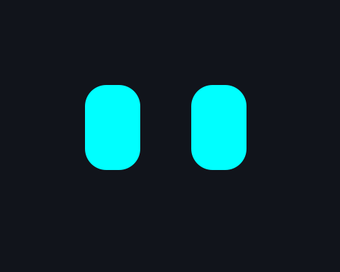
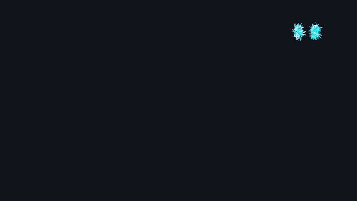
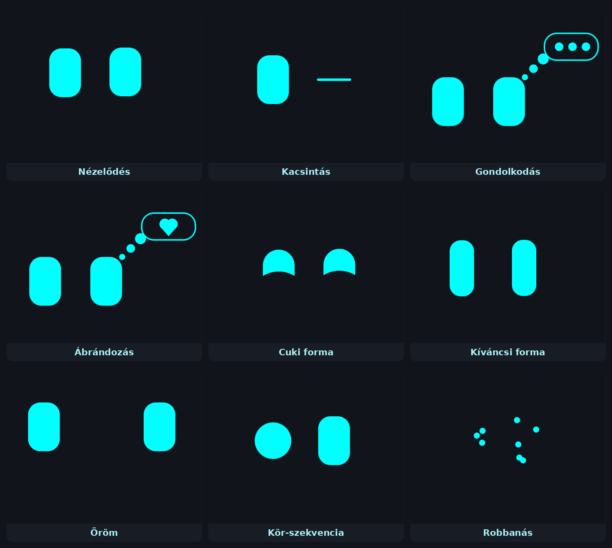
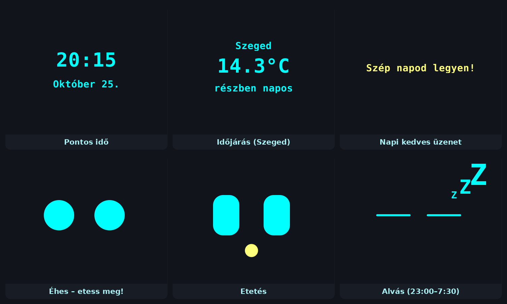
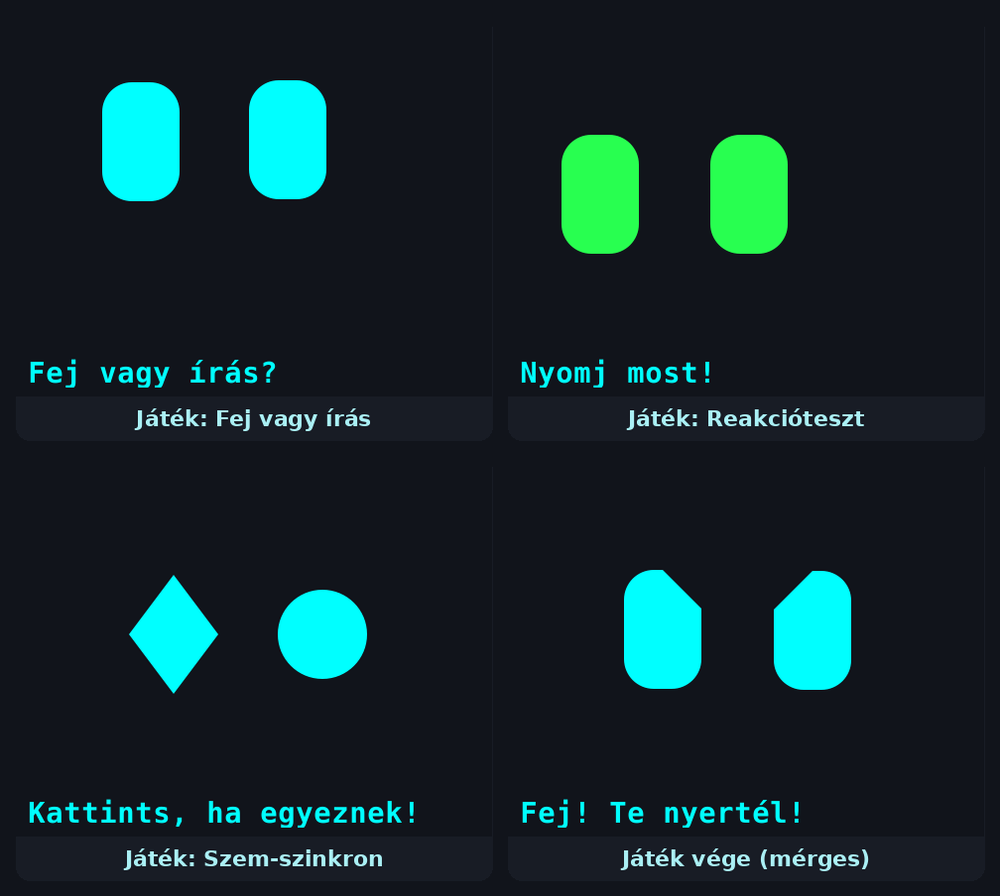
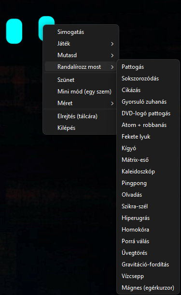
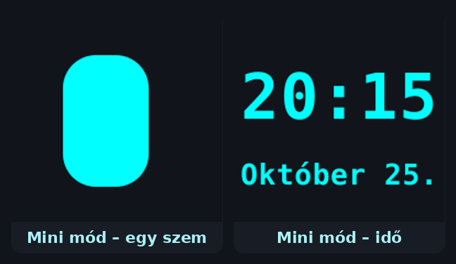

<div align="center">

# 👀 RobotEyes Widget

**Élő robotszemek a Windows asztalodra** – mindig az ablakok fölött, átlátszó háttérrel.<br>
Nézelődik, pislog, gondolkodik, játszik veled, megmondja az időt és az időjárást…<br>
…és ha 5 percig nem nyúlsz a géphez, **randalírozni kezd az egész képernyőn.**



*A szemek az [R.O.B.I. ESP32 projekt](https://github.com/zoltan-234/ROBI-esp32) MiniFace programjából születtek – most a számítógépeden élnek.*

[Telepítés](#-telepítés) · [Randalírozás](#-randalírozás--20-teljes-képernyős-animáció) · [Funkciók](#-a-szem-élete) · [Játékok](#-játékok) · [Kezelés](#kezelőfelület) · [Biztonság](#-biztonság-és-adatvédelem) · [📄 PDF útmutató](docs/RobotEyes-Widget_Telepitesi_utmutato.pdf)

</div>

---

## 💥 Randalírozás – 20 teljes képernyős animáció

Ha **5 percig** nem nyúlsz egérhez vagy billentyűzethez, a szemek kitörnek a kis ablakukból, és **azon a monitoron, ahol épp vannak**, végigszáguldanak az egész képernyőn. Utána **20 másodpercenként** jön a következő, véletlen sorrendben, ismétlés nélkül. **Bármilyen egérmozdulatra vagy gombnyomásra azonnal visszaugranak a helyükre.**

<table>
<tr>
<td align="center" width="50%"><br><b>⚛️ Atom + robbanás</b><br><sub>Három, 3D-ben forgó elektronpálya, középen egy óriás szem – összetömörödik, és pixelekre robban.</sub></td>
<td align="center" width="50%"><br><b>🚀 Hiperugrás</b><br><sub>A csillagok fénycsíkká nyúlnak, a szem remegve „kilő”, majd a túloldalról visszaérkezik.</sub></td>
</tr>
<tr>
<td align="center"><br><b>✨ Szikra-szél</b><br><sub>Szikrákká bomlik, a szél örvényekben hordja körbe, végül egy tölcsér visszagyűjti.</sub></td>
<td align="center"><br><b>🫠 Olvadás</b><br><sub>Lecsurog, fénylő tócsába gyűlik, a tócsa hullámzik – aztán a pixelek visszaszállnak.</sub></td>
</tr>
<tr>
<td align="center" colspan="2"><br><b>🐍 Kígyó</b><br><sub>A szempár a fej, mögötte egyre kisebb szemek kígyóznak – néha a saját farkát kergeti.</sub></td>
</tr>
</table>

<details>
<summary><b>Mind a 20 animáció listája</b></summary>

| | Animáció | Mit csinál |
|---|---|---|
| 1 | **Pattogás** | Végigpattog a képernyőn, a falnál zselészerűen lapul |
| 2 | **Sokszorozódás** | Megsokszorozódik → szétrepülnek → sorba állnak → körbe forognak → újra eggyé állnak |
| 3 | **Cikázás** | A két szem külön-külön, ívekben cikázik |
| 4 | **Gyorsuló zuhanás** | Lefelé zuhan, felül visszajön, egyre gyorsabban |
| 5 | **DVD-logó** | Átlósan pattog, minden falnál színt vált (sarokba találva örül) |
| 6 | **Atom + robbanás** | Elektronpályák 3D-ben, óriás mag, összetömörödés, pixelrobbanás |
| 7 | **Fekete lyuk** | Spirálban beszippantja (spagettivé nyúlik), majd kiköpi és újraépíti |
| 8 | **Kígyó** | Kígyózó szemlánc, a végén behúzódik a fejbe |
| 9 | **Mátrix-eső** | Zöld szemeső → óriás szempárrá áll össze |
| 10 | **Kaleidoszkóp** | 6-szoros tükörszimmetrikus, forgó, formaváltó, szivárványos minta |
| 11 | **Pingpong** | A szem a labda; az egyik ütő elhibázza, a szem szégyenlősen visszakukucskál |
| 12 | **Olvadás** | Lecsurog, tócsa, hullámzás, visszaszállás |
| 13 | **Szikra-szél** | Szikrák a szélben, örvény, tölcsér |
| 14 | **Hiperugrás** | Fénysebesség, kilövés, visszaérkezés a túloldalról |
| 15 | **Homokóra** | Homokká pereg, valódi kupac épül, a kép megfordul, visszapereg a szembe |
| 16 | **Porrá válás** | Az egyik szélétől hamuvá porlad, elfújja a szél – aztán visszafelé újraépül |
| 17 | **Üvegtörés** | Repedések, szilánkok, pattogás csillanással, majd visszatekerés |
| 18 | **Gravitáció-fordítás** | Le, jobbra, fel, balra hullik – minden falnál kupac, végül súlytalanság |
| 19 | **Vízcsepp** | Cseppé gyűlik, vízbe csapódik, hullámok, fröccsenés, felszökő vízoszlop |
| 20 | **Mágnes** | Vasreszelék-tűkként az egérkurzor köré gyűlik |

Bármelyik kézzel is indítható: menü → **Randalírozz most**.
</details>

---

## 🧠 A szem élete

A szemek nem csak egy animációt ismételnek: egy **állapotgép** és egy **súlyozott eseménysorsoló** 15–35 másodpercenként eldönti, mit csináljanak legközelebb – így sosem kiszámíthatók.

### Alap animációk



| Animáció | Leírás |
|---|---|
| **Nézelődés + pislogás** | Folyamatosan körbenéz, 3–7 mp-enként pislog |
| **Kacsintás** | Az egyik szemével rád kacsint |
| **Gondolkodás** | Félrenéz, gondolatbuborék pöttyökkel |
| **Ábrándozás** | Buborékban szív, hangjegy, hópehely, mosoly… |
| **Szemformák** | Kíváncsi (keskeny, magas), cuki (mosolygós ív), lapos, mérges, aggódó, kör |
| **Öröm** | Körbefordul, lehuppan, ruganyosan visszaugrik |
| **Kör-szekvencia** | Bal szem kör → jobb szem kör → mindkettő |
| **Cikázás / le-fel tűnés** | Gyors kis ugrálás, illetve egyre gyorsuló „kiesés” a keretből |
| **Robbanás** | Felfúvódik, szétpukkan részecskékre, majd visszanő |
| **Kurzorkövetés** | Néha egy ideig követi a szemével az egeredet |
| **Kukucskálás** | Elbújik a keret széle mögé (a monitor legközelebbi széle felé), aztán kikukucskál |

### Napi élet – idő, időjárás, kedves üzenetek



- **Pontos idő és dátum** – a szemek elhalványulnak, megjelenik az idő, aztán visszanőnek.
- **Időjárás** – az [Open-Meteo](https://open-meteo.com) ingyenes API-jából, óránként frissítve (alapból **Szeged**, átállítható).
- **Napi kedves üzenet** – 15 biztató mondat közül sorsol: *„Szép napod legyen!”, „Büszke vagyok rád!”, „Sose add fel!”…*
- **Éhség** – 30 / 60 / 120 / 180 percenként megéhezik (kör alakú szemek). Ha 1 percen belül megeteted (menü → *Etetés*), egy sárga golyót „bekap” és boldogan villog; ha nem, szomorú lesz.
- **Simogatás** – menü → *Simogatás*: kettőt boldogan ugrik.
- **Napi ritmus** – 22:30-tól lenyugszik (lapos szemek), **23:00 és 7:30 között alszik** (ZZZ), reggel felébred. Éjjel is felébresztheted a menüből 5 percre.

---

## 🎮 Játékok



| Játék | Hogyan |
|---|---|
| **Fej vagy írás** | Menü → *Fej* vagy *Írás*. A szem dob, és kiírja, ki nyert. Ha ő nyer, örül; ha te, megsértődik (mérges szemek). |
| **Reakcióteszt** | A szemek pirosak… várj… amikor **zöldre** váltanak és oldalra ugranak, kattints rájuk minél gyorsabban! Kiírja az időt (pl. *0.31 mp!*). Korai kattintás = csalás. |
| **Szem-szinkron** | A két szem folyamatosan alakot vált (kör, gyémánt, háromszög…). Kattints, amikor **pont egyformák**! |

---

## Kezelőfelület

<table>
<tr>
<td width="300"></td>
<td>

A szemek egy **átlátszó ablakban** élnek. A szemeket egy láthatatlan **belső téglalap** fogja össze – ha föléviszed az egeret, halvány keret jelzi.

| Mit csinálsz | Mi történik |
|---|---|
| **Kattintás** a téglalapra | Előjön a menü |
| **Megfogod és húzod** | Áthelyezed – akár a másik monitorra is |
| Kattintás a téglalapon **kívül** | Átmegy a mögötte lévő ablakra (nem zavar) |
| Kattintás kukucskálás / követés közben | Azonnal visszaáll |
| **Tálcaikon** bal klikk | Elrejt / megjelenít |
| **Tálcaikon** jobb klikk | Menü |

**Menü:** Simogatás · Etetés / Ébresztés · Játék · Mutasd (idő, kedves szó, időjárás) · Randalírozz most · Szünet · Mini mód · Méret · Elrejtés · Kilépés

</td>
</tr>
</table>

### Méretek és mini mód



- **Méret:** Pici · Kicsi · Közepes · Nagy
- **Mini mód:** ikonméretű, **egy szemmel** – minden funkció megmarad.
- **Szünet:** a szemek becsukódnak, minden időzítő megáll (az éhség sem nő).
- A hely, a méret és a mód **megmarad** a következő indításkor.

<br clear="right">

### Okos viselkedés

- 🎬 **Teljes képernyő = eltűnik.** Ha azon a monitoron YouTube, film vagy játék megy teljes képernyőn, a szemek elbújnak, utána visszajönnek.
- 🖥️🖥️ **Több monitor:** ott randalírozik, ahol épp van, annak a monitornak a méretében.
- 🪟 **Nem zavar:** mindig felül van, de nem veszi el a fókuszt, és a téglalapon kívül átengedi a kattintást.
- ▶️ **Csak akkor fut, ha elindítod.** Nem indul a Windows-zal, nem fut a háttérben, egyszerre csak egy példány lehet.

---

## 📦 Telepítés

> Részletes, képes útmutató technikai információkkal: **[📄 RobotEyes-Widget_Telepitesi_utmutato.pdf](docs/RobotEyes-Widget_Telepitesi_utmutato.pdf)**

1. Telepíts **[Python 3.10+](https://www.python.org/downloads/)**-t – a telepítőben pipáld be: **Add python.exe to PATH**.
2. Töltsd le a repót (**Code → Download ZIP**), és csomagold ki egy mappába.
3. Kattints duplán a **`build_exe.bat`**-ra.
   → elkészül a `dist\RobotEyes-Widget.exe`, és kerül egy **RobotEyes Widget** parancsikon az asztalra.
4. Indítsd a parancsikonnal. 🎉

<sub>Exe nélkül, közvetlenül Pythonból: `pip install -r requirements.txt`, majd `start.bat`.</sub>

**Frissítés:** tálcaikon → Kilépés → új fájlok felülírása → `build_exe.bat` újra (a beállítások megmaradnak).
**Eltávolítás:** `uninstall.bat` – leállítja, törli a parancsikont, a beállításokat és a mappát.

---

## 🔒 Biztonság és adatvédelem

Röviden – a teljes, részletes leírás a [PDF-ben](docs/RobotEyes-Widget_Telepitesi_utmutato.pdf) van.

| | |
|---|---|
| **Rendszergazdai jog** | ❌ Nem kell, nem kér |
| **Automatikus indulás** | ❌ Nincs (nem ír a Registrybe, nem tesz semmit az Indítópultba) |
| **Billentyűzet** | ❌ Nem figyeli, mit gépelsz – csak azt kérdezi meg a Windowstól, *mennyi ideje* nem nyúltál semmihez |
| **Képernyő** | ❌ Nem készít képernyőképet, nem lát bele más ablakokba – csak azt nézi, hogy az előtérben lévő ablak *teljes képernyős-e* |
| **Internet** | Óránként **egy** időjárás-lekérés az Open-Meteótól (csak a város koordinátái mennek ki). Semmi más. |
| **Adatgyűjtés / telemetria** | ❌ Nincs |
| **Fájlok** | Csak a saját beállításait írja: `%APPDATA%\RobotEyes-Widget\` |
| **Forráskód** | Nyílt, ~4600 sor Python – minden ellenőrizhető ebben a repóban |

---

## ⚙️ Beállítások (haladó)

| Mit | Hol | Alapérték |
|---|---|---|
| Tétlenség a randalírozás előtt | `main.py` → `IDLE_RAMPAGE_SEC` | 300 mp (5 perc) |
| Randalírozások közti idő | `main.py` → `RAMPAGE_REPEAT` | 20 mp |
| Méretek | `main.py` → `SIZES`, `MINI_SCALE` | 0.85 / 1.3 / 1.8 / 2.5 |
| Események gyakorisága | `miniface.py` → `eventWeights` | nagyobb szám = gyakoribb |
| Helyszín (időjárás) | `miniface.py` → `LAT`, `LON`, `CITY_NAME` | Szeged |
| Kedves üzenetek | `miniface.py` → `kindWords` | 15 mondat |
| Animáció simasága | `smooth.py` → `LOGIC_DT`, `POS_TAU` | 0.045 / 0.035 |

Módosítás után futtasd újra a `build_exe.bat`-ot.

## 📁 Felépítés

```
main.py            ablak, menü, tálcaikon, egér, randalírozás-ütemező
miniface.py        a szem "agya": állapotgép, események, játékok, éhség, napi ritmus, időjárás
render.py          a szemek, buborékok, szövegek kirajzolása
smooth.py          60 fps-es simítás, puha pislogás, szöveg-áttűnés
rampage.py         teljes képernyős animációk (1–6) + rugós mozgásfizika
rampage_extra.py   animációk 7–14
rampage_extra2.py  szétesős animációk 15–20 (homok-/szemcse-fizika)
winutil.py         Windows-segédek (tétlenség, teljes képernyő észlelés, átkattinthatóság)
build_exe.bat      exe + asztali parancsikon készítése
start.bat          indítás Pythonból
uninstall.bat      eltávolítás
```

**Technológia:** Python 3 · [PySide6 (Qt 6)](https://doc.qt.io/qtforpython-6/) · [PyInstaller](https://pyinstaller.org)<br>
**Időjárásadatok:** [Weather data by Open-Meteo.com](https://open-meteo.com/) ([CC BY 4.0](https://creativecommons.org/licenses/by/4.0/))

## 📜 Licenc

[MIT](LICENSE)
